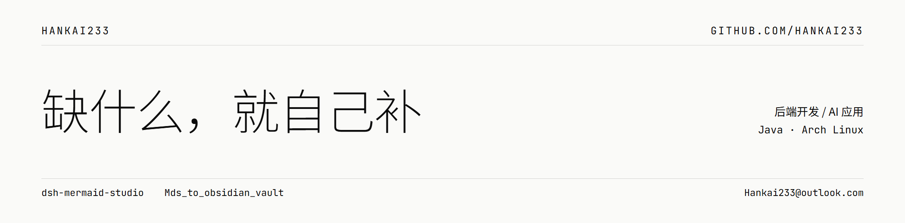

后端开发 / AI 应用。Java 写服务，RAG 和 Agent 在学。系统是 Arch，日常 niri + kitty。

**dsh-mermaid-studio** — DSH 会话里 mermaid 默认不渲染，多图同时刷新还会卡。现在代码块直接出图。

**Mds_to_obsidian_vault** — 把散在各处的 Markdown 整理成带 frontmatter、MOC 和反向链接的 Obsidian 仓库。

**联系** · [Hankai233@outlook.com](mailto:Hankai233@outlook.com)
