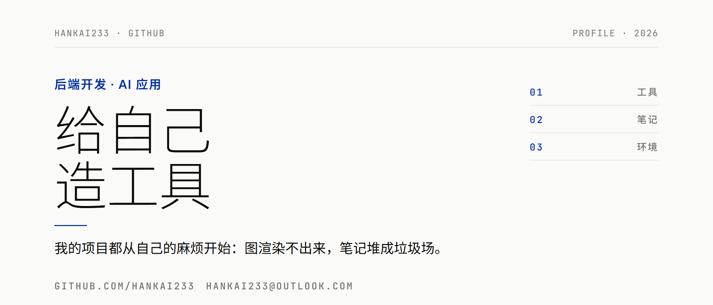
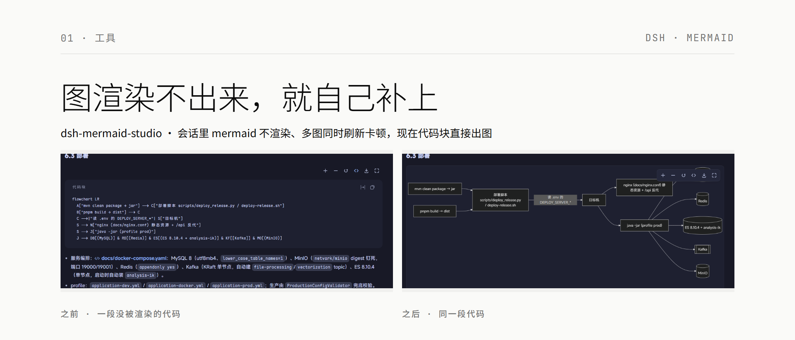
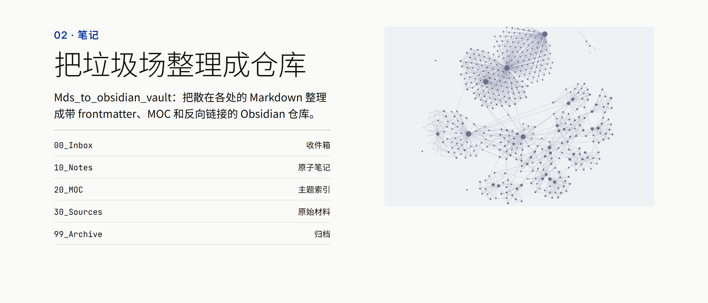
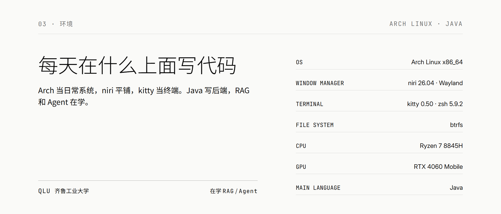

## 现在

后端开发，方向是 AI 应用。Java 写服务，RAG 和 Agent 在学。系统是 Arch，日常 niri + kitty，文件系统 btrfs。人在 QLU。

## 造的东西

**dsh-mermaid-studio** — DSH 会话里 mermaid 默认不渲染，多图同时刷新还会卡。装上之后代码块直接出图。

**Mds_to_obsidian_vault** — 把散在各处的 Markdown 整理成带 frontmatter、MOC 和反向链接的 Obsidian 仓库。

## 联系

邮箱：[Hankai233@outlook.com](mailto:Hankai233@outlook.com)
